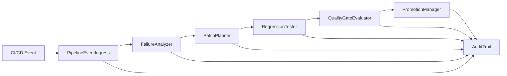

# Dependências entre Componentes

## Matriz de Dependência

| Componente | Depende de | Padrão de comunicação | Observação |
|---|---|---|---|
| `PipelineEventIngress` | Nenhum | Entrada de evento | Valida e normaliza o payload |
| `FailureAnalyzer` | `PipelineEventIngress`, contexto de repo | Estruturas de dados | Gera diagnóstico |
| `PatchPlanner` | `FailureAnalyzer` | JSON estruturado | Propõe correção focal |
| `RegressionTester` | `PatchPlanner` | Resultado de patch | Valida código em ambiente isolado |
| `QualityGateEvaluator` | `RegressionTester` | Resultado de testes | Aplica regras determinísticas |
| `PromotionManager` | `QualityGateEvaluator` | Decisão de gate | Controla avanço de ambientes |
| `AuditTrail` | Todos os componentes | Registro de eventos | Fonte de evidência e rastreio |
| `RuntimeOrchestrator` | Todos os serviços principais | Coordenação de workflow | Conecta o protótipo ao novo pipeline |

## Fluxo de Dados

## Observações

- A camada de IA gera recomendações e diagnósticos, mas a execução de mutação e promoção deve ser limitada pelo control plane.
- O `RuntimeOrchestrator` atua como orquestrador do fluxo e consolida o estado do ciclo completo.
- O `AuditTrail` é uma dependência transversal e não apenas um componente final do processo.
