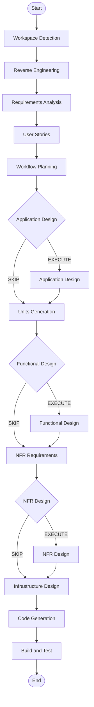

# Execution Plan

## Detailed Analysis Summary

### Transformation Scope

This is a **brownfield evolution** of an existing Python prototype into a target Self-Healing orchestration architecture. The current runtime is a learning ReAct flow under `application/`; the target is the event-driven architecture described by `docs/sdd/sdd_orquestrador_agentes_v2.md`.

### Change Impact Assessment

- **User-facing impact:** Moderate. The system will evolve from a demo question-answer runtime into an automated CI/CD support workflow.
- **Structural impact:** High. The orchestrator, specialist agents, and validation flow will need new event-driven and governance layers.
- **Data model impact:** High. New structured event, findings, patch, QA, and approval contracts are needed.
- **API impact:** High. The current local Python module interfaces will expand to include pipeline-event handling and policy-aware execution.
- **NFR impact:** High. Security, auditability, determinism, and resilience are central requirements.
- **Application layer impact:** High. The current prototype will need additional worker orchestration, validation logic, and policy-aware action handling.
- **Infrastructure layer impact:** Medium to High. The project may eventually require webhook exposure, CI/CD triggers, and controlled execution environments.

### Key Components Affected

- `application/agente.py` — runtime loop, session state, metrics, execution persistence
- `application/orquestrador.py` — orchestration of specialist tasks and flow coordination
- `application/especialistas.py` — specialist agents and contract definitions
- `application/ferramentas.py` — local tool registry and tool execution contracts
- `application/config.py` — provider, token, and runtime configuration
- `docs/sdd/sdd_orquestrador_agentes_v2.md` — target architecture and governance model

### Risk Assessment

**Risk level: High**

Reasons:
- The project changes the runtime’s purpose from a local demo to a governed CI/CD healing workflow.
- Multiple technical concerns intersect: event intake, diagnostics, patch proposal, QA, policy, and audit trail.
- The system impacts operational trust and production safety, so deterministic gates and human approval matter.

## Workflow Visualization

## Phases to Execute

### INCEPTION PHASE

- [x] Workspace Detection — completed; repository includes a brownfield Python prototype and SDD target architecture.
- [x] Reverse Engineering — completed; current runtime and target-state differences were documented.
- [x] Requirements Analysis — completed; requirements were captured around event-driven diagnosis, patching, testing, and governance.
- [x] User Stories — completed; stories cover diagnosis, patching, validation, and governance concerns.
- [x] Workflow Planning — completed; execution plan generated and ready for review.
- [ ] Application Design — recommended to execute before implementation.
- [ ] Units Generation — recommended to execute before implementation.

### CONSTRUCTION PHASE

- [ ] Functional Design — conditional; likely required once the target components and workflows are defined.
- [ ] NFR Requirements — recommended; security, resilience, and deterministic quality gates are essential.
- [ ] NFR Design — recommended; governance and guardrails must be incorporated into the architecture.
- [ ] Infrastructure Design — conditional; likely required for webhook, CI/CD, and isolated execution environment planning.
- [ ] Code Generation — required once the design is approved.
- [ ] Build and Test — required after implementation.

### OPERATIONS PHASE

- [ ] Operations — placeholder for future deployment, monitoring, and production-readiness workflows.

## Recommended Package / Component Update Sequence

1. **Baseline architecture documentation** — lock the target state described in `docs/sdd/sdd_orquestrador_agentes_v2.md` as the source of truth for design decisions.
2. **Runtime contract layer** — update `application/agente.py` and `application/orquestrador.py` to support structured pipeline events and execution state.
3. **Specialist and tool contracts** — evolve `application/especialistas.py` and `application/ferramentas.py` so they can represent diagnosis, patch proposal, and QA work.
4. **Config and governance layer** — add stricter validator, policy, and guardrail logic in `application/config.py` and adjacent modules.
5. **Regression and audit tests** — tighten tests and tracing around failure handling, patch validation, and auditability.
6. **Promotion and production controls** — add approval flows and deterministic gates in later increments after the core pipeline is stable.

## Estimated Timeline

- **Inception and planning:** 1-2 days
- **Architecture design and unit decomposition:** 1-2 days
- **Core implementation of diagnosis + patch + QA pipeline:** 3-5 days
- **Regression testing and governance hardening:** 2-3 days
- **Total effective timeline:** 1-2 weeks for a controlled first milestone

## Success Criteria

The project succeeds when:

- the current prototype is clearly evolved toward the SDD-driven architecture,
- the orchestration flow can model a CI/CD failure and produce structured diagnosis,
- patch proposals and QA are gated before promotion,
- auditability and controls are traceable,
- and the basic project progression is supported by regression tests and milestone reviews.

## Status

This plan is ready for review. The recommended next phase is **Application Design**, followed by **Units Generation** and then the implementation increments for diagnosis and validation logic.
