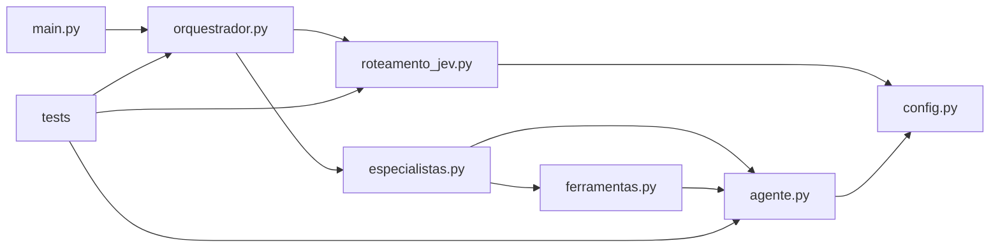

# API and Dependencies — Current Workspace

## REST APIs and Event Interfaces

No REST endpoint, webhook handler, OpenAPI document, or service API is
currently implemented.

The SDD v2 proposes a `PipelineFailureEventSchema` as a future event contract.
Its required fields are `event_id`, `pipeline_id`, `repository_url`, `branch`,
`commit_hash`, `failure_stage`, and `error_log_raw`; optional fields include
environment and trigger timestamp. This schema is architecture documentation,
not a validated runtime contract in the current application.

## Internal APIs

The following functions and types are the primary current interfaces. They
are Python module APIs, not network endpoints.

### Runtime — `application/agente.py`

| Symbol | Signature / shape | Purpose |
|---|---|---|
| `Ferramenta` | Dataclass: `nome`, `descricao`, `parametros`, `funcao` | Describes a callable tool and its JSON Schema-like input definition. |
| `Ferramenta.definicao_para_api` | `definicao_para_api(self) -> dict` | Converts a tool into the Anthropic tool-definition shape. |
| `Agente` | Dataclass: name, system prompt, tools, effort, level, latest metrics, optional session ID | Configures an agent instance. |
| `Agente.executar` | `executar(self, tarefa: str) -> str` | Executes the ReAct loop and returns final text or an explicit limit/refusal marker; propagates provider and token-budget errors. |
| `Agente._chamar_modelo` | `_chamar_modelo(self, mensagens: list)` | Calls the configured Anthropic or OpenRouter provider. |
| `Agente._executar_ferramenta` | `_executar_ferramenta(self, mapa: dict, bloco) -> dict` | Invokes a registered tool and returns a structured `tool_result`, including `is_error` on failure. |
| `extrair_json` | `extrair_json(texto: str)` | Extracts a JSON object/array from model text or a Markdown code fence. |
| `registrar_execucao` | `registrar_execucao(agente_nome: str, tarefa: str, resposta: str, metrica: dict) -> dict` | Appends execution data to local JSON history. |
| `resumo_historico` | `resumo_historico() -> dict` | Aggregates counts, timing, tokens, and recent executions. |
| `criar_sessao` | `criar_sessao(sessao_id: str, pergunta: str | None = None, status: str = "iniciada") -> dict` | Initializes or updates local execution state for a session. |
| `atualizar_status_sessao` | `atualizar_status_sessao(sessao_id, status, etapa=None, metrica=None, pergunta=None, resposta=None) -> dict` | Updates session state and latest status. |
| `registrar_artefato` | `registrar_artefato(sessao_id, nome, tipo, conteudo, metadados=None) -> dict` | Stores an artifact in local execution state. |
| `registrar_etapa_execucao` | `registrar_etapa_execucao(sessao_id, etapa, status, detalhes=None) -> dict` | Appends a stage event to local execution state. |
| `registrar_sessao` | `registrar_sessao(sessao_id, pergunta, resposta, metrica) -> dict` | Persists a conversation entry and updates state/artifacts. |
| `ler_estado_execucao` / `salvar_estado_execucao` | Read/write local state `dict` | Loads or persists local execution state. |

### Demo Flow — `application/orquestrador.py`

| Symbol | Signature / shape | Purpose |
|---|---|---|
| `delegar` | `delegar(especialista: str, tarefa: str) -> str` | Finds a registered specialist and executes its task. |
| `validar_resposta_final` | `validar_resposta_final(pergunta: str, resposta: str, limite_palavras: int = 150) -> dict` | Checks non-empty question/answer and word limit. |
| `executar_fluxo_padrao` | `executar_fluxo_padrao(pergunta: str) -> str` | Runs research, optional analysis, writing, and review. |
| `executar_fluxo_padrao_json` | `executar_fluxo_padrao_json(pergunta: str) -> dict` | Returns the demo response and word-limit validation as a dictionary. |

### Specialists and Local Tools

| Module | Public interface | Purpose |
|---|---|---|
| `application/especialistas.py` | `pesquisador`, `analista`, `redator`, `revisor`, `ESPECIALISTAS`, `CONTRATOS_SAIDA`, `DESCRICOES` | Specialist agents, registry and prompt-level output contracts. |
| `application/ferramentas.py` | `buscar_na_base(termo: str) -> str` | Searches the fixed sample knowledge base. |
| `application/ferramentas.py` | `calcular(expressao: str) -> str` | Evaluates supported numeric AST operations and formats the result. |
| `application/ferramentas.py` | `contar_palavras(texto: str) -> str` | Counts whitespace-separated words. |
| `application/ferramentas.py` | `BUSCAR`, `CALCULAR`, `CONTAR_PALAVRAS` | Tool metadata/registrations presented to the LLM. |

### Jev Routing — `application/roteamento_jev.py`

| Symbol | Signature | Purpose |
|---|---|---|
| `decidir_rota` | `decidir_rota(pergunta: str, fatos: dict) -> dict` | Uses TypeSafe Jev to return a validated `analisar` or `explicar` choice, confidence, and probabilities. |
| `ROTAS` | `{"analisar", "explicar"}` | Supported route set. |

## Data Models and Contracts

### Current Runtime Shapes

- **Tool definition:** tool name, description, input schema, Python callable.
- **Tool result:** `type="tool_result"`, `tool_use_id`, string `content`, and
  optional `is_error=True`.
- **Execution metric:** number of model steps, input/output/total tokens,
  configured token budget, elapsed seconds, and optional error text.
- **Local session state:** status, question/answer, latest step/metrics,
  interactions, artifacts, timestamps, and a history of execution stages.
- **Specialist output:** researcher and analyst are asked to emit JSON; current
  validation parses JSON but does not fully enforce a JSON Schema.

### Target Contracts Documented by SDD v2

- `PipelineFailureEventSchema`: event identity, pipeline/repository/commit
  context, failure stage, raw log, optional environment and timestamp.
- `SelfHealingReportSchema`: root-cause analysis, patch information,
  regression-test status, and promotion status.
- `FindingContract`: finding ID, category, severity, location, description,
  and remediation suggestion.

These target contracts are not yet implemented or validated in Python code.

## Internal Dependencies

Text alternative: the CLI calls the orchestration module, which dispatches
specialists and routing. Specialists and local tools use the shared runtime;
runtime and routing both read configuration. Tests import and mock these
modules.

| Dependency | Type | Reason |
|---|---|---|
| `main.py` -> `orquestrador.py` | Runtime | Starts the demo flow. |
| `main.py` -> persistence helpers in `agente.py` | Runtime | Prints local session and execution summaries. |
| `orquestrador.py` -> `agente.py` | Runtime | Uses agent/tool abstractions and JSON extraction. |
| `orquestrador.py` -> `especialistas.py` | Runtime | Delegates work and reads specialist contracts. |
| `orquestrador.py` -> `roteamento_jev.py` | Runtime | Selects quantitative-analysis vs explanation route. |
| `especialistas.py` -> `agente.py` | Runtime | Creates specialist agents. |
| `especialistas.py` -> `ferramentas.py` | Runtime | Assigns local tools to specialist agents. |
| `agente.py`, `roteamento_jev.py`, `especialistas.py` -> `config.py` | Runtime | Reads providers, credentials, model settings, and limits. |
| `tests/*` -> application modules | Test | Verifies behavior with `unittest` and mocks. |

## External Dependencies

Declared in `application/requirements.txt`:

| Package | Version constraint | Use |
|---|---|---|
| `anthropic` | `>=1.3.0` | Anthropic Messages client. |
| `openai` | `>=1.0.0` | OpenAI-compatible SDK used to call OpenRouter. |
| `python-dotenv` | `>=1.0.0` | Optional loading of `.env` values. |
| `typesafe-sdk` | Unpinned | TypeSafe Jev typed routing. |

The tests use `pytest` as the runner, but it is not included in the application
requirements file. Python standard-library dependencies include `unittest`,
`json`, `ast`, `concurrent.futures`, `dataclasses`, `pathlib`, `time`, and
`operator`.

No internal package dependency, REST dependency, database, or infrastructure
package was detected.

## Known Integration and Contract Gaps

- No webhook/API interface exists yet for CI/CD events.
- No authentication, event replay protection, or event deduplication exists.
- No repository, CI log, Slack/Teams, Git provider, or deployment API client
  exists in the application.
- Tool permissions are defined by agent registration, not by an external
  deny-by-default PEP/PDP.
- Current JSON contracts are prompt guidance and parsing, not schema-enforced
  contracts.
- Local JSON persistence is mutable and does not provide transactions,
  concurrency guarantees, retention control, or immutable audit semantics.
- Test coverage is unit/flow-focused with mocked LLM/TypeSafe clients; no
  integration tests against real external services or CI/CD were found.
