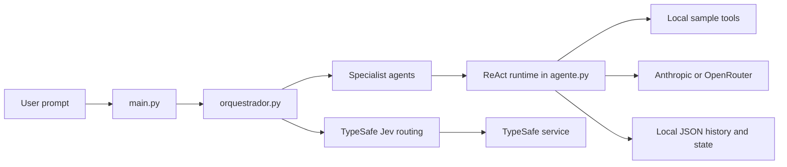
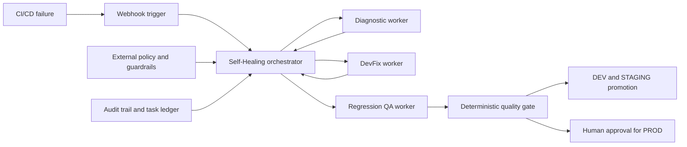
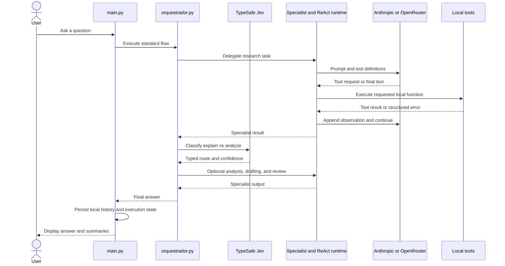

# System Overview — Current Workspace and Self-Healing Target

## Business Context

### Business Description

This workspace is a learning project for corporate AI-agent orchestration. Its
current application demonstrates a ReAct loop and an orchestrator-workers
pattern. The intended destination, specified by SDD v2, is an event-driven
Self-Healing system for diagnosing CI/CD failures, proposing and testing
focused fixes, and controlling any promotion through deterministic policy and
quality gates. SDD v2 also includes a corporate code-review pipeline; this
workflow start focuses on the Self-Healing subsystem while retaining that
broader SDD scope as related architecture context.

The existing demo answers user questions using a small local knowledge base.
It does not yet consume pipeline failures or modify a repository.

### Business Transactions

Implemented today:

1. **Answer a user question:** A user supplies a prompt (or the demo prompt);
   the application delegates research, optional quantitative analysis,
   drafting, and review to specialist agents.
2. **Route a question:** Jev chooses whether a question needs quantitative
   analysis or explanation, when Jev routing is enabled.
3. **Use a local tool:** A specialist searches the sample knowledge base,
   evaluates a restricted arithmetic expression, or counts words.
4. **Record an execution:** The application stores execution metrics,
   responses, session summaries, and execution state in local JSON files.

Target-state transactions from SDD v2, not implemented:

1. Receive a pipeline-failure event through a webhook.
2. Retrieve logs and repository context to produce a structured diagnosis.
3. Propose a focused patch and regression tests.
4. Run tests in an isolated sandbox and evaluate deterministic gates.
5. Prepare a PR and DEV/STAGING promotion; request human approval for
   Production promotion.

### Business Dictionary

| Term | Meaning |
|---|---|
| ReAct | Runtime loop that alternates model reasoning, tool execution, and observations. |
| Orchestrator-workers | Pattern where a coordinator delegates self-contained tasks to specialist agents. |
| Self-Healing | Target capability to diagnose pipeline failures and propose/test remediation. |
| Pipeline failure event | Target input carrying identifiers, repository/commit context, failure stage, and logs. |
| Finding | Structured diagnostic result, such as a root cause or code-quality/security issue. |
| PEP/PDP | Policy Enforcement Point / Policy Decision Point, external to the model, for authorizing actions. |
| Quality gate | Deterministic rule that evaluates tests/security results and controls workflow progression. |
| DEV / STAGING / PROD | Development, homologation/staging, and production environments. |
| Human-in-the-Loop | Explicit human review/approval for high-impact actions, especially Production promotion. |

## System Architecture

### Current Architecture

Text alternative: user prompt -> demonstration flow -> Jev routing and
specialist agents -> ReAct runtime -> local sample tools and LLM provider;
execution/session information is persisted locally as JSON.

### Target Architecture from SDD v2

Text alternative: a CI/CD event triggers diagnosis, patch proposal, isolated
regression testing, and deterministic quality gates; external policies govern
tool actions and Production promotion requires the approval described by SDD
v2.

### Current Data Flow

Text alternative: the standard flow gathers local facts, asks Jev whether
analysis is needed, optionally delegates calculation, then drafts and reviews
the answer. The CLI displays the result and local history summaries.

### Components

| Component | Type | Responsibility | Dependencies |
|---|---|---|---|
| `application/main.py` | CLI application | Accepts a user prompt, invokes the standard flow, prints the answer and history summaries. | `orquestrador.py`, local JSON persistence helpers. |
| `application/orquestrador.py` | Application orchestration module | Runs the demo sequence: research, Jev route, optional analysis, drafting, review, and final response validation. | `agente.py`, `especialistas.py`, `roteamento_jev.py`. |
| `application/agente.py` | Runtime / provider client / persistence module | Implements agent tool loop, Anthropic/OpenRouter clients, parallel tool execution, metrics, JSON helpers, session and execution persistence. | Anthropic SDK, OpenAI SDK, `config.py`, filesystem JSON. |
| `application/especialistas.py` | Agent definitions | Defines researcher, analyst, writer, and reviewer agents, their prompts, tools, and output contracts. | `agente.py`, `ferramentas.py`, `config.py`. |
| `application/ferramentas.py` | Local tools | Implements sample search, restricted arithmetic evaluation, and word counting. | Python standard library and `agente.py`'s `Ferramenta`. |
| `application/roteamento_jev.py` | External decision client | Calls TypeSafe Jev to choose analysis vs explanation and validates the choice/confidence. | `typesafe-sdk`, `config.py`. |
| `application/config.py` | Configuration module | Loads `.env`, selects provider/model, stores limits and validates provider credentials. | `python-dotenv` when installed. |
| `application/tests/` | Test package | Exercises JSON parsing, history, flow, OpenRouter protocol, and Jev routing with mocks. | `unittest`, `pytest`, mocked external SDKs. |
| `docs/` | Documentation | Holds the learning guidelines, Step 1 plan, and Self-Healing SDD v2. | None. |

## Code Structure and Patterns

### Build and Test

- Language: Python; configured workspace interpreter observed as Python 3.14.7.
- Dependency manifest: `application/requirements.txt`.
- Tests: `unittest` test cases executed by `pytest`.
- Baseline command (from `application/`): `python -m pytest tests -q`.
- Baseline result during this analysis: **16 passed**.
- No separate compile/build system or application CI workflow was found.

### Existing Source Inventory

| Path | Purpose |
|---|---|
| `application/agente.py` | Agent/tool dataclasses, provider calls, ReAct loop, OpenRouter response adapter, JSON extraction, execution/session persistence. |
| `application/config.py` | Environment loading, provider/model settings, iteration/token/parallelism limits, credential validation. |
| `application/especialistas.py` | Specialist agent prompts, tools, contracts, and registry. |
| `application/ferramentas.py` | Sample knowledge base, safe AST arithmetic evaluator, word counter, tool schemas. |
| `application/main.py` | CLI entry point and output/history presentation. |
| `application/orquestrador.py` | Delegation tool, demo flow, Jev routing, contracts, final word-limit validation. |
| `application/roteamento_jev.py` | TypeSafe Jev route choice and validation. |
| `application/requirements.txt` | Python dependency declarations. |
| `application/.env.example` | Example provider configuration with placeholder keys; local `.env` is excluded from this analysis. |
| `application/tests/test_execucao_historico.py` | Execution history record and aggregate summary tests. |
| `application/tests/test_json_utils.py` | JSON extraction tests. |
| `application/tests/test_openrouter_client.py` | OpenRouter tool-call protocol and runtime-control tests. |
| `application/tests/test_orquestrador_flow.py` | Standard flow and response-validation tests. |
| `application/tests/test_roteamento_jev.py` | Jev route client tests with mocked SDK. |

### Patterns Observed

- **ReAct/tool calling:** `Agente.executar` repeats model calls and tool invocations until a final status or limit.
- **Orchestrator-workers:** `delegar` dispatches a self-contained task to a registered specialist.
- **Provider adapter:** OpenRouter Chat Completions is normalized to an internal response shape compatible with the loop.
- **Structured contracts by prompt:** Specialist JSON output is parsed, but the demo does not perform full JSON Schema validation.
- **Parallel tool calls:** Tool invocations requested in one assistant response are executed via `ThreadPoolExecutor`.
- **Local JSON persistence:** Metrics and state are stored in local JSON files, without an immutable audit guarantee.
- **Test doubles:** External LLM and routing behavior is tested using mocks; there are no live CI or deployment integrations.

## Component Inventory

- Application packages: 1 (`application/`, a Python module collection rather than a separately packaged distribution).
- Infrastructure packages: 0 detected.
- Shared packages: 0 detected.
- Test packages: 1 (`application/tests/`).
- Documentation areas: `docs/` and AI-DLC artifacts in `aidlc-docs/`.
- Total application/infrastructure/shared/test packages: 2.

## Integrations and Runtime State

### Current External Integrations

- **Anthropic Messages API:** LLM provider option via `anthropic` SDK.
- **OpenRouter Chat Completions API:** LLM provider option via `openai` SDK with OpenRouter base URL and headers.
- **TypeSafe Jev:** Typed route selection via `typesafe-sdk`, when enabled.

Provider credentials are expected via environment variables or local `.env`.
Secrets were not opened or copied into these artifacts.

### Current Local State

The runtime writes session, execution-history, and execution-state JSON files
under `application/`. They are local mutable files and are not a substitute
for a durable, access-controlled, tamper-evident audit store.

### Infrastructure Discovery

No application Dockerfile, container orchestration manifest, Terraform,
CloudFormation, CDK package, webhook server, HTTP API definition, deployment
script, or application CI/CD workflow was detected in the current workspace.
The containers, event trigger, security plane, and deployment flow in SDD v2
are architecture targets only.

## Technology Stack

| Technology | Version / declaration | Purpose |
|---|---|---|
| Python | 3.14.7 observed interpreter | Application and tests. |
| `anthropic` | `>=1.3.0` | Anthropic model client. |
| `openai` | `>=1.0.0` | OpenRouter-compatible client. |
| `python-dotenv` | `>=1.0.0` | Load environment from local `.env`. |
| `typesafe-sdk` | Unpinned | Jev routing client. |
| `pytest` | Installed in active environment; not declared in `requirements.txt` | Test runner. |
| Python standard library | Runtime-provided | Thread pool, JSON, AST, filesystem, timing, dataclasses, and unittest. |

## Current-State Gaps Against SDD v2

The existing code does not yet implement:

- webhook event ingestion, event validation, deduplication, or authentication;
- repository/CI log retrieval and repository-aware root-cause diagnosis;
- DevFix patch generation/application, branch creation, or Pull Request creation;
- isolated sandboxing for code/test execution;
- a QA worker that creates and runs regression suites against candidate patches;
- a deterministic promotion quality gate;
- external PEP/PDP policy enforcement, deny-by-default tool permissions, or risk metadata;
- input/output guardrails for prompt injection, secrets, or PII;
- immutable audit trail, durable task ledger, timeout/rollback, or healing retry policy;
- controlled DEV/STAGING deployment and Production human approval workflow.

These are target requirements in the SDD, not existing behavior.
