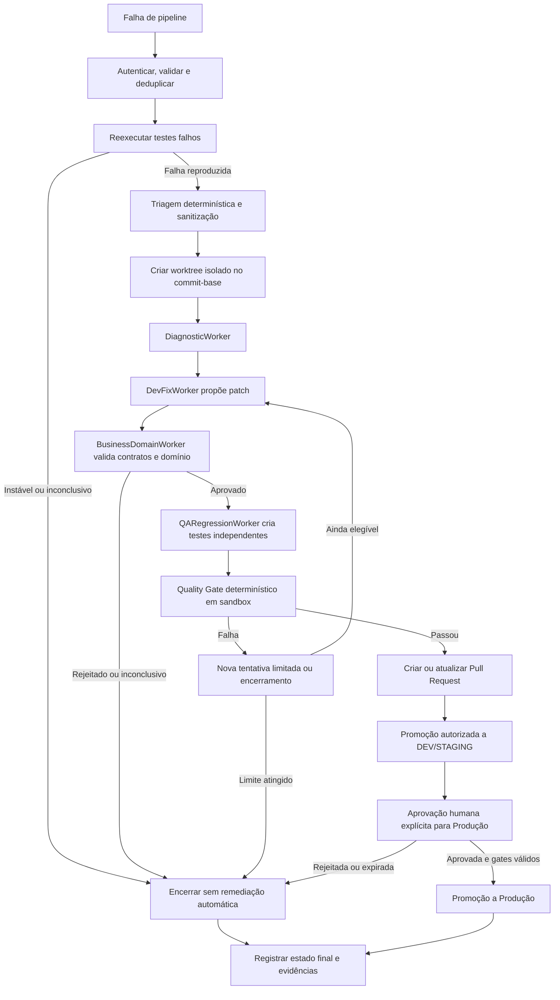

# Software Design Document (SDD): Orquestrador Corporativo de Agentes e Auto-Remediação de CI/CD

**Versão:** 5.0

**Status:** Referência arquitetural consolidada (arquitetura-alvo; implementação incremental)

**Data:** 2026-10-14

**Escopo:** Revisão de código e auto-remediação de pipelines com agentes heterogêneos, validação maker-checker, proteção de contratos, resiliência de CI/CD e governança determinística.

> **Nota de status:** Este SDD define a arquitetura-alvo. Sua aprovação documental não significa que os componentes estejam implementados, certificados ou prontos para produção. O protótipo atual em `application/` permanece um exercício de runtime ReAct e orquestrador-trabalhadores; webhook, diagnóstico do repositório, aplicação segura de patches, sandbox, autorização externa, promoção CI/CD e aprovação de produção são capacidades futuras.

---

## 1. Visão geral

### 1.1 Propósito

Este documento consolida as decisões arquiteturais das versões anteriores em uma referência única para evoluir o projeto em direção a um sistema corporativo de revisão de código e auto-remediação de falhas de CI/CD.

O sistema usa modelos de linguagem para produzir análises, diagnósticos, propostas de patch e testes. Componentes determinísticos e o plano de controle mantêm a autoridade sobre autenticação, autorização, execução de ferramentas, alterações persistentes, qualidade e promoção de ambientes. Nenhuma saída de LLM, isoladamente, autoriza uma mutação ou implantação.

### 1.2 Objetivos

- Receber eventos autenticados de falha de pipeline e processá-los de forma idempotente.
- Distinguir falhas reproduzíveis de resultados inconclusivos ou potencialmente instáveis antes de consumir recursos de agentes.
- Diagnosticar falhas com contexto mínimo e sanitizado do pipeline e do repositório.
- Propor correções isoladas, verificar contratos e regras de domínio e testar regressões.
- Controlar toda ação mutável por políticas determinísticas, isolamento, limites e trilha de auditoria.
- Gerar um Pull Request e, mediante gates e políticas, promover somente para ambientes permitidos.
- Exigir aprovação humana explícita para qualquer promoção a Produção.

### 1.3 Fora do escopo desta versão

- Conceder autonomia irrestrita a agentes para executar comandos, realizar merge ou promover a Produção.
- Tratar filtros de texto como defesa suficiente contra prompt injection.
- Garantir que uma correção gerada por IA esteja correta apenas porque testes gerados ou existentes passaram.
- Substituir os controles, revisões e políticas da plataforma CI/CD ou do repositório.
- Afirmar suporte a um provedor, modelo, cloud, linguagem ou ferramenta específica sem validação de integração.

### 1.4 Princípios arquiteturais

1. **Separação entre raciocínio e autoridade:** modelos recomendam; o plano de controle autoriza e executa.
2. **Deny-by-default:** qualquer ação sem política explícita, contexto válido ou evidência suficiente é negada.
3. **Menor privilégio:** cada trabalhador recebe apenas dados, ferramentas e permissões indispensáveis à sua tarefa.
4. **Validação independente:** desenvolvimento, validação de domínio e QA usam contextos separados; quando viável, o modelo de QA difere do modelo que propôs o patch.
5. **Dados externos não confiáveis:** logs, arquivos do repositório, comentários e documentos recuperados são dados, nunca instruções de controle.
6. **Falha explícita:** erro, timeout, resultado inválido ou validação inconclusiva interrompe o caminho de promoção; não há fallback com aparência de sucesso.
7. **Isolamento de alterações:** alterações ocorrem em worktree efêmero, associado ao commit-base validado, nunca diretamente no branch de origem.
8. **Evidência auditável:** cada decisão e transição de estado referencia resultados verificáveis e registra a identidade do ator ou componente responsável.
9. **Promoção gradual:** autonomia limitada a ambientes e ações autorizados; Produção exige aprovação humana.

---

## 2. Contexto e arquitetura

### 2.1 Planos lógicos

| Plano | Responsabilidades |
|---|---|
| **Execução e inteligência** | Orquestrar trabalhadores isolados para diagnóstico, proposta de correção, revisão de domínio e QA. Não possui autoridade implícita para mutações ou deploy. |
| **Controle e política** | Validar identidade, escopo, estado, autorização, quotas e gates; controlar ferramentas e executar ou negar ações. Inclui PEP e PDP externos ou equivalentes determinísticos. |
| **Ciclo de vida e evidências** | Registrar eventos e resultados, gerir tentativas, integrar com CI/CD e repositório, manter auditoria e controlar PRs e promoções. |

### 2.2 Visão do fluxo



O fluxo é serial quanto às decisões que dependem do patch: a validação de domínio ocorre antes da geração/execução de testes de regressão e todos os resultados necessários são verificados pelo plano de controle. Paralelismo pode ser usado apenas para etapas independentes e não pode contornar dependências ou gates.

### 2.3 Roteamento de trabalhadores

Os nomes de modelos abaixo são exemplos conceituais, não uma seleção obrigatória de fornecedores. O roteador deve usar catálogo aprovado, limites de custo e disponibilidade. A identidade do modelo, versão, parâmetros e provedor usados devem constar nos metadados de execução.

| Trabalhador | Responsabilidade | Restrições |
|---|---|---|
| **DiagnosticWorker** | Resumir falha, localizar arquivos/símbolos prováveis e apresentar evidências do diagnóstico. | Leitura apenas; deve referenciar logs/arquivos de origem e separar fatos de hipóteses. |
| **DevFixWorker (Maker / LLM A)** | Propor diff pequeno que enderece a causa raiz observada. | Não aplica alterações diretamente; recebe apenas o contexto necessário; não pode alterar políticas ou gates. |
| **BusinessDomainWorker (Checker / LLM C)** | Avaliar compatibilidade de contratos, testes existentes e regras de negócio. | Parecer estruturado; resultado inconclusivo bloqueia promoção; RAG não concede autoridade. |
| **QARegressionWorker (LLM B)** | Propor testes que reproduzam a falha e detectem regressões relevantes. | Contexto isolado do raciocínio privado do Maker; não pode enfraquecer testes existentes. |
| **DeploymentPromotionWorker** | Solicitar operações Git/CI/CD e promoção após validações. | Executor determinístico sem LLM; toda ação passa pelo PEP/PDP e usa credenciais de escopo mínimo. |

Nenhum trabalhador deve expor ou depender da cadeia privada de raciocínio de outro agente. Interfaces entre trabalhadores contêm apenas instruções operacionais, evidências selecionadas e resultados estruturados.

---

## 3. Fluxo de auto-remediação

1. **Ingestão:** autenticar a origem do webhook; validar assinatura, timestamp, tamanho, esquema e identificador do evento; rejeitar eventos não autorizados ou expirados.
2. **Deduplicação:** usar chave idempotente derivada do provedor e do identificador do evento. Reentrega retorna/retoma o estado existente; não cria uma remediação concorrente duplicada.
3. **Reprodutibilidade:** reexecutar somente testes falhos, no mesmo commit e em ambiente equivalente quando possível, com no máximo duas reexecuções. Se uma reexecução passar ou os resultados divergirem, classificar como `INCONCLUSIVE` (candidata a falha intermitente), encerrar a remediação automática e registrar/alertar. Isso não prova que a causa foi infraestrutura.
4. **Fast-path:** tentar primeiro verificações determinísticas de baixo risco. Formatadores e linters só podem editar se autorizados pela política, no worktree isolado, e o diff precisa passar pelos mesmos controles posteriores. Alterações semânticas não são aceitas como correção automática de Nível 0.
5. **Sanitização e classificação:** remover/mascarar segredos e PII conforme política, limitar tamanho, codificação e retenção e preservar proveniência. Conteúdo não confiável permanece identificado como dado, sem ser interpretado como instrução.
6. **Worktree:** criar área efêmera vinculada ao repositório autorizado e ao `commit_hash` validado. Verificar que o HEAD de origem não mudou antes de gerar PR ou efetuar operação dependente dele.
7. **Diagnóstico e patch:** executar os trabalhadores com contexto mínimo. O Maker fornece patch proposto e justificativa estruturada, não uma operação executável arbitrária.
8. **Validação de domínio:** verificar integridade de contratos, preservação dos testes e regras funcionais disponíveis. Parecer `REJECTED` ou `INCONCLUSIVE` bloqueia QA de promoção.
9. **QA e execução:** gerar testes focados, então executar os testes antigos e novos, análise estática, verificações de segurança aplicáveis e gates do repositório em sandbox efêmero.
10. **PR e promoção:** criar/atualizar PR após aprovação dos gates. Deploy em DEV/STAGING requer política explícita. Produção exige aprovação humana para a versão exata do artefato e commit aprovados.
11. **Fechamento:** persistir o estado final, evidências, motivo de bloqueio e resultado de limpeza do worktree. Limpeza incompleta gera alerta operacional.

### 3.1 Portão anti-flaky

- A reexecução deve preservar, tanto quanto possível, commit, seleção de testes, configuração e dependências originais.
- O número máximo é duas reexecuções por evento; um limite menor pode ser imposto pela plataforma.
- Resultado que diverge do original, inclusive um passe em qualquer reexecução, é `INCONCLUSIVE`; a automação não deve rotular categoricamente como falha de infraestrutura.
- Só uma falha consistente nas execuções autorizadas permite continuar como falha reproduzida.
- Falha ao reexecutar, ambiente não equivalente ou ausência de evidências suficientes também resulta em `INCONCLUSIVE`.

### 3.2 Fast-path e custo

| Nível | Ação | Condição de avanço |
|---|---|---|
| **0 — determinístico** | Verificações e correções mecânicas aprovadas pela política (por exemplo, formatação). | Diff limitado e permitido; verificações determinísticas passam. Caso contrário, reverter o resultado do fast-path no worktree e seguir para Nível 1 ou encerrar. |
| **1 — modelo econômico** | Diagnóstico/correção de baixa complexidade, como sintaxe ou imports. | Continua sujeito a revisão de contratos, sandbox, testes e quality gates. |
| **2 — comitê completo** | Fluxo com diagnóstico, Maker, Checker de domínio e QA. | Usado para falhas semânticas ou quando níveis anteriores não resolveram a falha. |

O roteador deve registrar nível, motivo e consumo. Falha de orçamento não pode reduzir gates ou promover um resultado parcial.

### 3.3 Dados contaminados e prompt injection indireto

- Tratar logs, nomes de branch, comentários de PR, arquivos de código e documentos RAG como conteúdo não confiável.
- Usar delimitação e metadados de proveniência nos prompts; não inserir conteúdo externo como instrução de sistema.
- Mascarar segredos/PII antes do envio a provedores e limitar dados à necessidade da tarefa.
- O modelo não pode transformar texto recuperado em chamada de ferramenta, comando ou autorização.
- Validar saídas contra esquemas, listas permitidas e política determinística; rejeitar conteúdo inválido.
- Sanitização de texto reduz exposição, mas não garante remoção de prompt injection. Isolamento de ferramentas e autorização fora do LLM são controles obrigatórios.

### 3.4 Worktree e consistência de Git

- Nomear branches efêmeras sem confiar diretamente em valores recebidos no webhook; normalizar e validar identificadores.
- Confirmar que repositório, branch e commit pertencem a origem autorizada; fixar o commit-base por hash imutável.
- Restringir caminhos alteráveis ao diretório do worktree; impedir traversal e acesso a arquivos fora do escopo.
- Não permitir `push`, merge ou alteração de branch principal sem política explícita e ação determinística autorizada.
- Antes de abrir/atualizar PR, comparar o estado de origem com o commit-base e tratar mudança concorrente como conflito; não rebasear ou sobrescrever silenciosamente.
- Remover worktree e credenciais temporárias ao fim, inclusive em falha; registrar o resultado de cleanup.

### 3.5 Hash de estado e detecção de ciclos

- Calcular fingerprint com **SHA-256** sobre uma representação canônica versionada que inclua estágio da falha, identificadores dos testes falhos e assinatura normalizada do erro.
- Normalização remove valores voláteis conhecidos (por exemplo, timestamps e caminhos temporários) sem eliminar informação necessária para distinguir falhas.
- Manter conjunto de fingerprints já vistos durante o mesmo evento; repetição de qualquer fingerprint encerra novas tentativas. Isso detecta também ciclo A → B → A.
- Associar o fingerprint ao evento e à versão do algoritmo de normalização. Não comparar indiscriminadamente entre eventos ou repositórios.
- Hash serve apenas para deduplicação/ciclo; não autentica dados, não substitui auditoria e não deve expor logs sensíveis.

### 3.6 Comentário único de progresso

Quando suportado pela plataforma, manter um comentário do bot por PR e atualizar o mesmo comentário (upsert) com estado resumido. Identificar o comentário por chave estável do bot/PR, proteger chamadas com autorização, limitar frequência, tratar falhas e não incluir segredos, PII, logs integrais ou cadeia privada de raciocínio. A falha de atualização não pode mudar o resultado do quality gate.

---

## 4. Contratos e esquemas

Os exemplos JSON abaixo são ilustrativos. A implementação deve publicar JSON Schema versionado (Draft 2020-12 ou versão explicitamente acordada), rejeitar propriedades inesperadas quando apropriado e aplicar limites de tamanho, formatos e enums. Segredos, tokens e logs integrais não devem constar em relatórios públicos.

### 4.1 Evento de falha (`PipelineFailureEvent`)

```json
{
  "schema_version": "1.0",
  "event_id": "string",
  "provider": "string",
  "pipeline_id": "string",
  "repository_id": "string",
  "repository_url": "https://example.invalid/repository",
  "branch": "string",
  "commit_hash": "40-character-commit-hash",
  "failure_stage": "string",
  "failed_tests": ["string"],
  "error_log": "bounded, untrusted text",
  "triggered_at": "RFC 3339 timestamp"
}
```

Campos obrigatórios: `schema_version`, `event_id`, `provider`, `pipeline_id`, `repository_id`, `commit_hash`, `failure_stage` e `triggered_at`. `repository_url`, `branch` e `error_log` também são necessários para executar o fluxo de diagnóstico; a ausência de informação essencial resulta em rejeição ou estado `INCONCLUSIVE`. `environment`, `failed_tests` e outros metadados podem ser opcionais quando fornecidos pela integração.

### 4.2 Parecer de domínio (`BusinessDomainCheck`)

```json
{
  "schema_version": "1.0",
  "check_id": "string",
  "mode_executed": "UNIVERSAL_CONTRACT_INTEGRITY",
  "status": "APPROVED",
  "approved": true,
  "checked_specifications": ["string"],
  "violations": [
    {
      "type": "BREAKING_API_CHANGE",
      "rule_or_file": "string",
      "description": "string",
      "severity": "BLOCKING"
    }
  ],
  "guidance_for_dev_agent": "string"
}
```

`mode_executed` aceita `UNIVERSAL_CONTRACT_INTEGRITY` ou `ADVANCED_BUSINESS_RAG`; `status` aceita `APPROVED`, `REJECTED` ou `INCONCLUSIVE`. `approved` só pode ser verdadeiro quando `status` for `APPROVED` e não houver violação bloqueante. Tipos de violação incluem `BREAKING_API_CHANGE`, `TEST_SUPPRESSION`, `DOMAIN_RULE_BREACH` e `CROSS_MODULE_IMPACT`. Resultado inconclusivo bloqueia avanço.

### 4.3 Relatório final (`SelfHealingReport`)

```json
{
  "schema_version": "1.0",
  "healing_id": "string",
  "event_id": "string",
  "pipeline_id": "string",
  "base_commit": "string",
  "final_status": "COMPLETED",
  "attempts_count": 1,
  "resilience": {
    "reproducibility_status": "REPRODUCED",
    "fast_path_level": 2,
    "error_state_hash": "sha256:...",
    "error_state_hash_version": "1"
  },
  "diagnosis": {
    "error_type": "string",
    "affected_files": ["string"],
    "summary": "string"
  },
  "business_domain_check": {
    "mode_executed": "ADVANCED_BUSINESS_RAG",
    "status": "APPROVED",
    "check_id": "string"
  },
  "patch": {
    "worktree_branch": "string",
    "diff_reference": "protected audit reference",
    "diff_sha256": "string"
  },
  "quality_gates": {
    "status": "PASSED",
    "checks": ["string"]
  },
  "pull_request": {
    "url": "string",
    "status": "OPEN"
  },
  "promotion": {
    "dev_status": "NOT_REQUESTED",
    "staging_status": "NOT_REQUESTED",
    "production_approval_status": "NOT_REQUESTED",
    "approver_id": null
  },
  "audit_reference": "string"
}
```

`final_status` deve distinguir pelo menos `COMPLETED`, `BLOCKED`, `INCONCLUSIVE` e `FAILED`. Estados de promoção devem distinguir não solicitado, pendente, aprovado, rejeitado e falhou. Referências a diffs e logs devem apontar para armazenamento protegido; não transportar conteúdo sensível em comentários ou relatórios de uso amplo.

---

## 5. Proteção de contratos e domínio

### 5.1 Modo universal: integridade de contratos

Ativo mesmo quando o repositório não possui documentação formal:

- Detectar mudanças incompatíveis em APIs, schemas, assinaturas públicas e tipos de retorno, usando ferramentas determinísticas quando disponíveis.
- Detectar remoção, desativação, skip, redução de asserções ou alteração suspeita dos testes existentes.
- Identificar impacto cruzado em módulos e contratos referenciados.
- Tratar qualquer alteração de teste existente como mudança sujeita a revisão; não inferir intenção maliciosa sem evidência, mas bloquear supressão de cobertura necessária à falha.

### 5.2 Modo avançado: regras de domínio e RAG

Ativado quando existem fontes de domínio aprovadas, como OpenAPI, BDD `.feature`, documentos funcionais ou especificações:

- Recuperar apenas fontes permitidas e registrar identificador, versão e trecho/citação utilizado.
- Avaliar regras funcionais relevantes ao patch; distinguir requisitos explícitos de inferência do modelo.
- Verificar proveniência e tratar documentos recuperados como não confiáveis para instruções operacionais.
- Parecer do LLM é evidência auxiliar; validadores determinísticos de contrato mantêm precedência quando aplicável.
- Ausência, conflito, desatualização ou ambiguidade de especificação deve resultar em `INCONCLUSIVE` ou revisão humana, não em aprovação presumida.

---

## 6. Qualidade, testes e isolamento

### 6.1 Gates mínimos para PR e promoção

- Testes que reproduzem a falha e suíte preexistente relevante passam no commit do patch.
- Quality gates requeridos pelo repositório passam; qualquer gate indisponível ou ignorado é explicitamente reportado e não equivale a sucesso.
- Nenhum teste preexistente necessário foi removido, desativado ou enfraquecido para obter aprovação.
- Validadores de contratos, análise estática e verificações de segurança requeridas passam.
- Diff está limitado aos caminhos e ao escopo autorizados; alterações inesperadas bloqueiam.
- O artefato testado é o mesmo artefato identificado no PR e submetido à promoção.

### 6.2 Sandbox

- Executar compilação e testes em ambiente efêmero isolado, sem rede externa por padrão.
- Não montar credenciais do host, socket do Docker, diretórios pessoais ou segredos não necessários.
- Limitar CPU, memória, tempo, tamanho de saída, processos e armazenamento.
- Tratar scripts de build e testes do repositório como código não confiável.
- Se a execução exigir rede ou privilégio adicional, interromper e exigir política explícita e revisão; não abrir acesso automaticamente.

### 6.3 Independência do QA

QA recebe a falha original, requisitos relevantes, diff proposto e instrução para criar testes; não recebe o raciocínio privado do Maker. O QA deve tentar reproduzir o defeito e cobrir comportamento de borda. Um modelo diferente reduz correlação de erro, mas não garante independência nem correção; por isso os gates continuam determinísticos.

---

## 7. Segurança, governança e auditoria

### 7.1 PEP/PDP e ferramentas

- Todas as operações com efeito externo passam por um PEP que consulta decisão explícita do PDP ou mecanismo equivalente.
- Política verifica ator, evento, repositório, commit, branch, ambiente, operação, escopo de arquivo, orçamento e estado dos gates.
- A política nega por padrão diante de timeout, erro, decisão ausente, identidade inválida ou dados inconsistentes.
- Allowlist de ferramentas/comandos com argumentos tipados; proibir execução de shell arbitrária derivada de texto do modelo.
- Credenciais efêmeras e de escopo mínimo; separar permissões de leitura, criação de branch/PR e deploy.
- Decisões de política são externas ao prompt e não podem ser alteradas por trabalhadores.

### 7.2 Aprovação de Produção

- Toda promoção a Produção exige aprovação humana autenticada e explícita.
- A aprovação referencia imutavelmente o PR, commit, artefato, resultado dos gates e ambiente de destino.
- Alteração do commit/artefato após aprovação invalida a aprovação e exige nova revisão.
- Aprovação expirada, ambígua, emitida por identidade não autorizada ou obtida por canal não confiável é rejeitada.
- Gates determinísticos são pré-requisitos, não substitutos da aprovação humana.

### 7.3 Tiers de autonomia

| Tier | Escopo | Controle |
|---|---|---|
| **T1 — Observação** | Leitura autorizada, diagnóstico e relatório. | Sem alteração de repositório ou ambiente. |
| **T2 — Produção supervisionada** | Solicitar promoção de artefato validado para Produção. | Aprovação humana obrigatória, mais todos os gates e política externa. |
| **T3 — Não-produção controlada** | Worktree, patch proposto, testes, PR e promoção a DEV/STAGING. | Execução apenas em escopo autorizado, gates determinísticos, auditoria e rollback operacional. |
| **T4 — Infraestrutura não produtiva** | Ações limitadas e pré-aprovadas de infraestrutura em ambiente não produtivo. | Desabilitado por padrão; requer política separada, escopo explícito, limites e auditoria. |

Tier não é autorização por si só. O PDP avalia cada operação individualmente.

### 7.4 Auditoria, privacidade e retenção

A trilha deve registrar, em armazenamento com controle de acesso e proteção contra alteração:

- Recebimento, autenticação, validação e deduplicação do evento.
- Estado de cada etapa, ator/componente, timestamps, decisão de política e razão de bloqueio.
- Versões de prompts/configuração relevantes, provedor/modelo, consumo de tokens e ferramentas acionadas.
- Referências protegidas ao diagnóstico, diff, parecer, testes, logs de execução e resultados de gates.
- Aprovações humanas, identidade, escopo e versão exata do artefato.
- Resultado da limpeza de worktree e credenciais.

Minimizar e mascarar dados pessoais e segredos; definir retenção, acesso e exclusão conforme política organizacional e LGPD. “Imutável” deve ser implementado por controles verificáveis de armazenamento/auditoria e não apenas por um rótulo no documento.

---

## 8. Limites e tratamento de falhas

| Limite | Valor de referência da arquitetura-alvo | Escopo |
|---|---:|---|
| `MAX_REACT_STEPS_PER_WORKER` | 5 | Máximo por trabalhador e por execução do evento. |
| `MAX_HEALING_ATTEMPTS_PER_EVENT` | 2 | Tentativas completas de correção; reexecuções anti-flaky são contabilizadas separadamente e limitadas a duas. |
| `TOKEN_BUDGET_PER_EVENT` | 35.000 tokens | Total agregado de entrada e saída de todos os trabalhadores e tentativas no evento. |
| `MAX_FAILED_TEST_RERUNS` | 2 | Reexecuções para o portão anti-flaky antes de classificar como reproduzida ou inconclusiva. |

Estes valores são limites-alvo para configuração e validação, não afirmações de capacidade já implementada. Políticas de ambiente podem impor limites inferiores; nunca superiores sem revisão. O sistema deve contabilizar consumo de forma agregada; se a contabilidade não estiver disponível ou o limite for atingido, interromper o fluxo sem reduzir verificações.

### 8.1 Estados e falhas

- **BLOCKED:** controle negou ação ou regra explícita impediu avanço.
- **INCONCLUSIVE:** evidência insuficiente, conflito entre resultados, flakiness suspeita ou validação indisponível.
- **FAILED:** erro operacional ou técnico impediu completar etapa.
- **COMPLETED:** todas as etapas requeridas para o resultado declarado passaram; não implica promoção automática a Produção.

Retries de webhook, ferramentas ou workers devem ser limitados, idempotentes e sujeitos a backoff. Erros não devem ser convertidos em aprovação, resultado vazio aceito ou sucesso aparente. Cada encerramento deve registrar etapa, código de erro não sensível, ação tentada e possibilidade de retomada manual.

---

## 9. Observabilidade e operação

- Correlacionar métricas e logs por `event_id` e `healing_id`; não usar PII, segredo ou log bruto como label de métrica.
- Métricas: eventos recebidos/rejeitados, reentregas deduplicadas, resultados do anti-flaky, tentativas, tokens/custo, tempo por etapa, bloqueios por política, gates, falhas de cleanup e promoções.
- Alertar para falha de autenticação, aumento de inconclusivos, excedentes de orçamento, erro de autorização, sandbox indisponível e cleanup incompleto.
- Disponibilizar estado atual e histórico resumido ao operador, sem expor conteúdo sensível nem raciocínio privado.
- Definir runbooks para interrupção segura, revogação de credenciais, remoção de worktree, retomada manual e incidentes de promoção.

---

## 10. Evolução e roteiro de implementação

Implementar por incrementos verificáveis. Cada fase preserva o modo de observação ou execução manual até seus gates serem testados e aprovados; ativar automação mutável exige revisão de segurança e política.

1. **Contratos e controle:** esquemas versionados, ingestão autenticada, idempotência, estados explícitos e trilha de auditoria.
2. **Execução segura de diagnóstico:** sanitização, proveniência, limites, observação do portão anti-flaky e diagnóstico somente leitura.
3. **Maker e worktree:** criação de patch proposto em worktree efêmero, verificação de commit-base, hashing de estado e limpeza.
4. **Checker de domínio e QA:** modo universal, RAG aprovado, testes independentes e execução em sandbox.
5. **PR e promoção não produtiva:** quality gates, integração de comentário único e promoção controlada para DEV/STAGING.
6. **Produção supervisionada:** aprovação humana vinculada a artefato, validação de política e trilha de auditoria operacional.
7. **T4 opcional:** somente após avaliação de risco própria, escopo não produtivo mínimo e aprovação explícita de política.

O avanço entre fases depende de testes, observabilidade, controles operacionais, resposta a falhas e evidência de que negações e timeouts falham de forma segura.

---

## 11. Critérios de aceitação arquitetural

- Evento inválido, não autenticado, expirado ou duplicado não inicia mutação nem duplica execução.
- Resultado anti-flaky divergente encerra automação como `INCONCLUSIVE`, sem afirmar causa-raiz de infraestrutura.
- Nenhum texto proveniente de logs, PR, código ou RAG pode autorizar ferramenta, alterar política ou executar comando.
- Toda alteração fica confinada ao worktree e commit-base autorizados; mudança concorrente bloqueia operação dependente.
- Repetição de fingerprint ou ciclo dentro do evento interrompe novas tentativas.
- Rejeição ou inconclusão do Checker, execução de teste falha ou gate indisponível impede promoção.
- Nenhum agente executa alterações fora do escopo; comandos, rede e credenciais seguem deny-by-default.
- Aprovação de Produção é humana, autenticada, vinculada ao artefato exato e invalidada por mudança desse artefato.
- Budget agregado é aplicado por evento; atingir ou não conseguir medir o limite falha explicitamente.
- Auditoria contém evidências protegidas e permite reconstruir decisões sem armazenar PII/segredos desnecessários.
- Worktree e credenciais temporárias são limpos; falha de limpeza é detectável e alertada.

---

## 12. Pendências, riscos e alternativas

### 12.1 Decisões a validar antes de produção

- Provedor de CI/CD, sistema de repositório, mecanismo de identidade e plataforma de execução da sandbox.
- PDP/PEP, linguagem de política e processo de governança das alterações de política.
- Fontes RAG aprovadas, proprietários, versionamento, atualização, classificação e tratamento de documentos conflitantes.
- Política organizacional de PII, mascaramento, armazenamento de logs, retenção e localização de dados.
- Limites por linguagem/projeto para duração de testes, recursos de sandbox e critérios específicos de quality gate.
- SLOs, estratégia de recuperação/rollback e responsáveis por incidentes.
- Critério de seleção e substituição de modelos, tratamento de indisponibilidade e limites financeiros.

### 12.2 Riscos a monitorar

- Falso diagnóstico ou teste insuficiente mesmo quando gates passam.
- Dependência excessiva de modelo/provedor e deriva de comportamento entre versões.
- Prompt injection em conteúdo do repositório ou documentos recuperados, mitigada por isolamento e controles determinísticos, não eliminada por sanitização.
- Diferenças entre reexecução anti-flaky e ambiente original podem tornar o resultado inconclusivo.
- Worktree/sandbox mal configurado pode expor host, credenciais ou rede.
- Fingerprint excessivamente amplo pode parar eventos distintos; excessivamente restrito pode não detectar ciclos.
- Ferramentas de formatação podem gerar diffs grandes ou semanticamente relevantes.
- Tokens, logs e contexto enviados a provedores podem conter dados sensíveis se a minimização não for efetiva.

### 12.3 Alternativas não adotadas

- **Aprovação automática de Produção somente por quality gate:** não adotada; gates são pré-requisito, aprovação humana continua obrigatória.
- **MD5 como fingerprint preferencial:** substituído por SHA-256 versionado; nenhum hash é mecanismo de autorização.
- **Classificar qualquer reexecução que passa como falha de infraestrutura:** substituído por estado inconclusivo/candidata a instabilidade.
- **Confiar em filtro textual para neutralizar prompt injection:** não adotado; defesa requer fronteiras de confiança, validação e ausência de autoridade do modelo.
- **Aplicar patch diretamente no branch de origem:** não adotado; worktree efêmero e commit-base fixado reduzem colisão e impacto.

---

## 13. Referências e relação com as versões anteriores

Esta versão consolida os conceitos de agentes heterogêneos, maker-checker, proteção de domínio e governança da v3 com o modo dual de validação, mecanismos de resiliência, isolamento por worktree e controles de ciclo de vida detalhados na v4.

As versões anteriores devem ser mantidas como histórico. Ao adotar esta versão como referência ativa, atualizar links e documentação de entrada do repositório em uma alteração coordenada para evitar referências divergentes. A adoção deste SDD não altera, por si só, o estado do código em `application/`.
